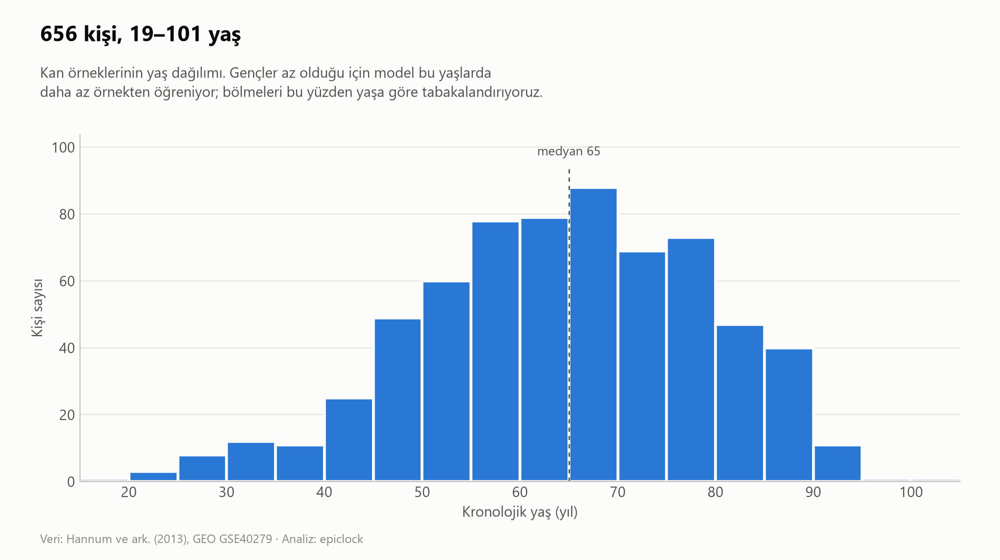
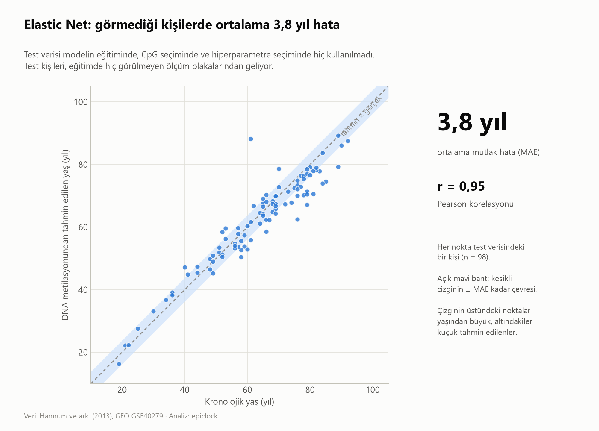
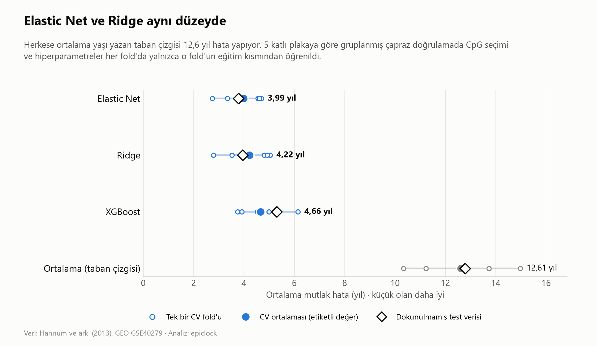
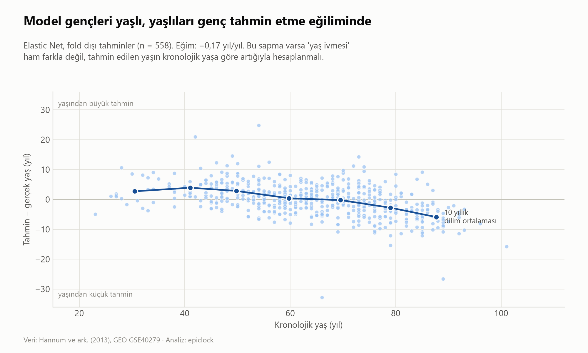
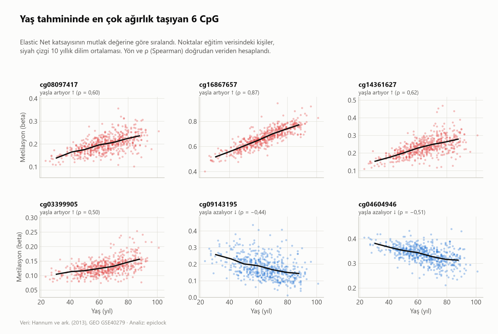
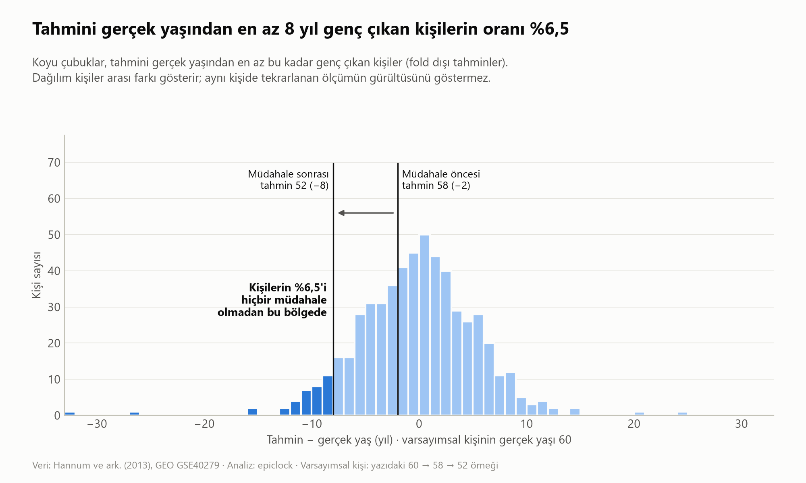
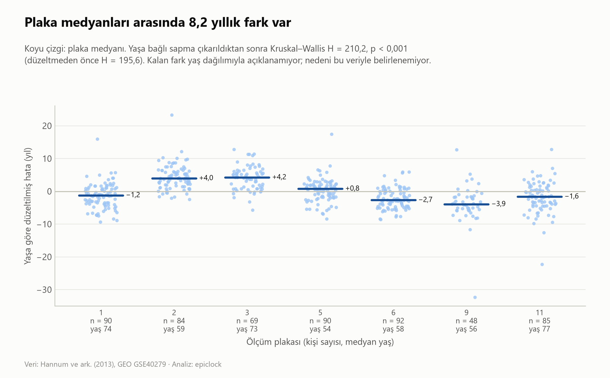

# epiclock: GSE40279 ile epigenetik yaş tahmini

Hannum ve ark. (2013) verisiyle (GEO **GSE40279**, 656 kan örneği, 19-101 yaş) DNA
metilasyonundan kronolojik yaş tahmini. Projenin amacı, birinci nesil bir epigenetik saatin
nasıl kurulduğunu ve nerelerde yanılabileceğini sızıntısız bir değerlendirmeyle göstermek.

İlgili Medium yazısının bağlantısı: https://medium.com/@ssenturkilayda/ya%C5%9Flanmay%C4%B1-makine-%C3%B6%C4%9Frenmesiyle-%C3%B6l%C3%A7ebilir-miyiz-epigenetik-saatler-ve-gen%C3%A7le%C5%9Fme-ara%C5%9Ft%C4%B1rmalar%C4%B1-052181289458?sharedUserId=ssenturkilayda

**English summary.** Chronological age prediction from blood DNA methylation (GSE40279, n = 656)
with Ridge, Elastic Net and XGBoost. CpG selection, imputation and scaling are fitted inside
cross-validation folds to avoid leakage. With a random split, Ridge and Elastic Net reach a test
MAE of about 3.2–3.4 years. When whole measurement plates are held out, error increases
(Elastic Net CV MAE 3.30 → 3.99 years) and plate-level differences in age-adjusted error remain.

## Sonuçlar

Rastgele bölme (eğitim 524, test 132, yaşa göre tabakalı), `--k 5000`:

| Model | CV MAE | Test MAE | Test RMSE | Test r |
|---|---|---|---|---|
| Ortalama (taban çizgisi) | 12,00 | 11,56 | 13,93 | — |
| Ridge | 3,29 | 3,23 | 4,33 | 0,95 |
| Elastic Net | 3,30 | 3,36 | 4,51 | 0,95 |
| XGBoost (sabit ayarlar) | 3,95 | 4,15 | 5,43 | 0,92 |

Plakaya göre bölme (test plakaları 8 ve 10; eğitim 558, test 98), cinsiyet eklenmiş, `--k 5000`:

| Model | CV MAE | Test MAE | Test RMSE |
|---|---|---|---|
| Ridge | 4,22 | 3,95 | 5,56 |
| Elastic Net | 3,99 | 3,78 | 5,28 |
| XGBoost (sabit ayarlar) | 4,66 | 5,30 | 6,70 |

Karşılaştırma için: Hannum ve ark. RMSE olarak birincil grupta 3,88, bağımsız doğrulama
grubunda 4,89 yıl raporlamıştır. Kurulumlar birebir aynı değildir (aşağıdaki sınırlamalara bakın).

Yazıdaki sayılar bu kaynak kod arşivine dahil olmayan, yerel PyCharm çalıştırmalarından raporlanmıştır. Kodu çalıştırıp kaydedilmiş sonuç dosyalarını ürettikten sonra `report_numbers.py` ile yeniden hesaplanabilir.

## Kurulum

```bash
python -m venv .venv
source .venv/bin/activate          # Windows: .venv\Scripts\activate
pip install -r requirements.txt
```

## Yazıdaki sonuçları yeniden üretme

```bash
python -m pytest -q                                      # 8 test
python run_pipeline.py --k 5000                          # rastgele bölme
python run_pipeline.py --k 5000 --split plate --sex      # plakaya göre bölme + cinsiyet
python run_pipeline.py --k 5000 --inner-selection        # iç CV'de de CpG seçimi
python report_numbers.py --run gse40279
python report_numbers.py --run gse40279_plate_sex
```

İlk çalıştırmada series matrix dosyası GEO'dan `data/raw/` klasörüne indirilir ve
`data/cache/` klasörüne `.npy` olarak kaydedilir (`data/` depoya dahil değildir).
Bellek: tüm matris float32 olarak yaklaşık 1,2 GB tutar; `--sex` bir kopya daha oluşturur.

Hızlı kod denemesi için gerçek veri gerekmez: `python run_pipeline.py --synthetic`.

## Veri sızıntısını nasıl önlüyoruz?

1. Test verisi en başta ayrılır ve yalnızca en sonda bir kez kullanılır.
2. Eksik değer doldurma, CpG seçimi (`SelectKBest`) ve ölçekleme bir `Pipeline` içindedir;
   her CV fold'unda yalnızca o fold'un eğitim kısmından öğrenilir.
3. "En iyi model" CV ortalamasına göre seçilir, test sonucuna göre seçilmez.
4. Varsayılan kurulumda ElasticNetCV/RidgeCV'nin **iç** CV'si, dış eğitim verisinin tamamıyla
   seçilmiş CpG'lerle çalışır. Bu, dış doğrulama ve test verisinden doğrudan bilgi sızdırmaz,
   ama hiperparametre seçimini iyimserleştirebilir. `--inner-selection` CpG seçimini iç CV'nin
   her parçasında yeniden yapar; gerçek veride sonuç değişmedi (Elastic Net CV MAE 3,30 → 3,29).
5. İlgili testler: `test_cpg_selection_uses_only_training_data`,
   `test_inner_selection_refits_selection_in_each_inner_fold`, `test_plate_split_keeps_plates_apart`.

## Seçenekler ve yardımcı betikler

| Komut | Ne yapar |
|---|---|
| `--split plate` | Plakaları bütün olarak ayırır (GroupShuffleSplit + GroupKFold) |
| `--sex` | Cinsiyeti, CpG seçiminden geçmeden modele ekler |
| `--inner-selection` | CpG seçimini iç CV'nin her parçasında yeniden yapar |
| `make_figures.py --run <klasör>` | Grafikleri modeli yeniden eğitmeden üretir |
| `report_numbers.py --run <klasör>` | Yazıdaki sayıları, AMAR ve plaka analizlerini yeniden hesaplar |
| `compare_runs.py` | Çalıştırmaları tek tabloda karşılaştırır |


## Grafikler

Bu bölümde GSE40279 veri setiyle gerçekleştirdiğim epigenetik yaş tahmini analizinin yedi görseli yer alıyor. Rastgele veri bölmesi ve plaka bazlı doğrulama farklı deneylerdir; sonuçları ayrı değerlendirilmelidir.

### 1. Veri setinin yaş dağılımı

Veri seti 19-101 yaş aralığında 656 kişiden oluşuyor. Medyan yaş 65. Genç yaşlarda daha az örnek bulunduğu için rastgele eğitim/test bölmesinde yaşa göre tabakalandırma kullandım.



### 2. Gerçek yaş ve tahmin edilen yaş

Elastic Net modelinin eğitim sırasında görmediği ölçüm plakalarından gelen 98 kişilik test kümesindeki performansı:

- **Test MAE:** 3,78 yıl
- **Pearson korelasyonu:** yaklaşık 0,95
- **Test örnek sayısı:** 98

Kesikli çizgi, tahmin edilen yaşın gerçek yaşa eşit olduğu noktaları gösteriyor.



### 3. Makine öğrenmesi modellerinin karşılaştırılması

Ölçüm plakalarına göre gruplandırılmış çapraz doğrulamada elde edilen ortalama mutlak hata (MAE) değerleri:

| Model | CV MAE (yıl) |
|---|---:|
| Elastic Net | 3,99 |
| Ridge | 4,22 |
| XGBoost | 4,66 |

Grafikte daireler çapraz doğrulama katlarını, elmaslar ayrı tutulan test kümesinin sonuçlarını gösteriyor.



### 4. Yaşa bağlı tahmin yanlılığı

Elastic Net'in kat dışı tahminleri (n = 558), modelin hata dağılımının yaşa göre değiştiğini gösteriyor.

Model genç kişileri olduğundan yaşlı, ileri yaştaki kişileri ise olduğundan genç tahmin etme eğilimi gösteriyor.

Bu nedenle tahmin edilen yaş ile kronolojik yaş arasındaki fark, tek başına biyolojik yaşlanma hızı olarak yorumlanamaz.



### 5. Yaş tahmininde en yüksek ağırlığa sahip altı CpG

Elastic Net'in en büyük mutlak katsayıları verdiği altı CpG bölgesinde metilasyon düzeylerinin yaşla ilişkisini inceledim.

Bu bölgeler arasında yaşlanma araştırmalarında bilinen ELOVL2 ve KLF14 ile ilişkili CpG'ler de bulunuyor.

Katsayı büyüklüğü, bir CpG'nin yaşlanmaya neden olduğunu göstermez.



### 6. Sekiz yıl daha genç tahmin edilmek ne anlama geliyor?

Plaka bazlı değerlendirmede kişilerin yaklaşık %6,5'inin tahmini yaşı, gerçek yaşından en az sekiz yıl düşük çıktı.

Grafikteki 60 → 58 → 52 örneği varsayımsaldır. Gerçek bir gençleşme müdahalesini temsil etmez.

Farklı kişilerin tahmin hataları, aynı bireyde tekrarlanan ölçümlerin değişkenliğini göstermez.



### 7. Ölçüm plakaları arasındaki farklılıklar

Yaşa göre düzeltilmiş tahmin hatalarının medyanları, ölçüm plakaları arasında yaklaşık 8,2 yıl farklılık gösterdi.

Kruskal–Wallis testinde p < 0,001 bulundu.

Ancak ölçüm plakaları ve örnek özellikleri ilişkili olduğu için bu farkın doğrudan teknik parti etkisinden kaynaklandığı söylenemez.



---

**Bilimsel yorum:** Bu proje, DNA metilasyonundan kronolojik yaş tahminini ve makine öğrenmesi modellerinin güvenilirliğini inceliyor. Grafikler biyolojik gençleşmeyi veya herhangi bir tedavinin etkinliğini kanıtlamıyor.

**Veri kaynağı:** [NCBI GEO - GSE40279](https://www.ncbi.nlm.nih.gov/geo/query/acc.cgi?acc=GSE40279)

## Bilinen sınırlamalar

- Hannum'un modeli cinsiyet, BMI, diyabet durumu, etnik köken ve ölçüm partisini cezasız
  değişken olarak içeriyordu. GEO dosyasında BMI ve diyabet bilgisi yok.
- Bu veride plaka ve etnik köken iç içe geçmiştir (Hispanik-Meksikalı örneklerin tamamı 5, 6 ve
  9 numaralı plakalarda). Plaka farklarının nedeni bu veriyle belirlenemiyor.
- Bağımsız bir dış veri setiyle doğrulama yapılmadı.
- `SelectKBest` hız için kullanılan tek değişkenli bir ön seçimdir, biyolojik bir seçim sayılmaz.
- Yazıdaki XGBoost sonuçları sabit ayarlarla elde edildi.
- Elastic Net'in seçtiği ceza değeri arama aralığının kenarına yakın ve bu bölgede yakınsama
  uyarıları görülüyor; sonuçlar iterasyon sayısından etkilenmedi.

## Veri ve kaynak

- Hannum, G. ve ark. (2013). Genome-wide Methylation Profiles Reveal Quantitative Views of Human
  Aging Rates. *Molecular Cell*, 49, 359-367. https://doi.org/10.1016/j.molcel.2012.10.016
- NCBI GEO, GSE40279: https://www.ncbi.nlm.nih.gov/geo/query/acc.cgi?acc=GSE40279
